# Database ER diagram

Generated from the verified PostgreSQL foreign-key catalog. SQL migrations are authoritative; `database/prisma/schema.prisma` is the original unused reference template. Composite keys enforce patient/order/encounter consistency.

```mermaid
erDiagram
    Department ||--o{ Appointment : "Appointment_departmentId_fkey"
    DoctorProfile ||--o{ Appointment : "Appointment_doctorId_fkey"
    PatientProfile ||--o{ Appointment : "Appointment_patientId_fkey"
    DoctorProfile ||--o{ Appointment : "appointment_provider_department"
    User ||--o{ AuditLog : "AuditLog_performedByUserId_fkey"
    User ||--o{ CareAssignment : "CareAssignment_nurseUserId_fkey"
    PatientProfile ||--o{ CareAssignment : "CareAssignment_patientId_fkey"
    PatientProfile ||--o{ ConsentRecord : "ConsentRecord_patientId_fkey"
    Encounter ||--o{ Diagnosis : "Diagnosis_encounterId_fkey"
    PatientProfile ||--o{ Diagnosis : "Diagnosis_patientId_fkey"
    DoctorProfile ||--o{ Diagnosis : "diagnosis_doctor"
    Encounter ||--o{ Diagnosis : "diagnosis_encounter_patient"
    DoctorProfile ||--o{ DoctorAvailability : "DoctorAvailability_doctorId_fkey"
    Department ||--o{ DoctorProfile : "DoctorProfile_departmentId_fkey"
    User ||--o{ DoctorProfile : "DoctorProfile_userId_fkey"
    Appointment ||--o{ Encounter : "Encounter_appointmentId_fkey"
    DoctorProfile ||--o{ Encounter : "Encounter_doctorId_fkey"
    PatientProfile ||--o{ Encounter : "Encounter_patientId_fkey"
    Appointment ||--o{ Encounter : "encounter_appointment_association"
    Encounter ||--o{ Invoice : "Invoice_encounterId_fkey"
    PatientProfile ||--o{ Invoice : "Invoice_patientId_fkey"
    Encounter ||--o{ Invoice : "invoice_encounter_patient"
    Invoice ||--o{ InvoiceItem : "InvoiceItem_invoiceId_fkey"
    User ||--o{ LabOrder : "LabOrder_assignedTechnicianUserId_fkey"
    Encounter ||--o{ LabOrder : "LabOrder_encounterId_fkey"
    DoctorProfile ||--o{ LabOrder : "LabOrder_orderingDoctorId_fkey"
    PatientProfile ||--o{ LabOrder : "LabOrder_patientId_fkey"
    Encounter ||--o{ LabOrder : "lab_encounter_patient"
    LabOrder ||--o{ LabResult : "LabResult_labOrderId_fkey"
    PatientProfile ||--o{ LabResult : "LabResult_patientId_fkey"
    LabOrder ||--o{ LabResult : "lab_result_patient"
    User ||--o{ LabResult : "result_technician"
    User ||--o{ LabResult : "result_validator"
    User ||--o{ Notification : "Notification_userId_fkey"
    Notification ||--o{ NotificationDelivery : "NotificationDelivery_notificationId_fkey"
    User ||--o{ PatientProfile : "PatientProfile_userId_fkey"
    Invoice ||--o{ Payment : "Payment_invoiceId_fkey"
    Invoice ||--o{ Payment : "payment_invoice_patient"
    DoctorProfile ||--o{ Prescription : "Prescription_doctorId_fkey"
    Encounter ||--o{ Prescription : "Prescription_encounterId_fkey"
    PatientProfile ||--o{ Prescription : "Prescription_patientId_fkey"
    Encounter ||--o{ Prescription : "prescription_encounter_patient"
    Prescription ||--o{ PrescriptionItem : "PrescriptionItem_prescriptionId_fkey"
    User ||--o{ RefreshToken : "RefreshToken_userId_fkey"
    Encounter ||--o{ VitalSigns : "VitalSigns_encounterId_fkey"
    PatientProfile ||--o{ VitalSigns : "VitalSigns_patientId_fkey"
    Encounter ||--o{ VitalSigns : "vital_encounter_patient"
    User ||--o{ VitalSigns : "vital_recorder"
    Department ||--o{ WaitingList : "WaitingList_departmentId_fkey"
    DoctorProfile ||--o{ WaitingList : "WaitingList_doctorId_fkey"
    PatientProfile ||--o{ WaitingList : "WaitingList_patientId_fkey"
```

- **Appointment.Appointment_appointmentNumber_key:** UNIQUE ("appointmentNumber")
- **Appointment.appointment_association:** UNIQUE (id, "patientId", "doctorId")
- **Appointment.appointment_no_overlap:** EXCLUDE USING gist ("doctorId" WITH =, tstzrange("scheduledStartTime", "scheduledEndTime", '[)'::text) WITH &&) WHERE ((status <> ALL (ARRAY['CANCELLED'::"AppointmentStatus", 'NO_SHOW'::"AppointmentStatus", 'RESCHEDULED'::"AppointmentStatus"])))
- **Appointment.appointment_positive_duration:** CHECK (("scheduledEndTime" > "scheduledStartTime"))
- **CareAssignment.CareAssignment_patientId_nurseUserId_key:** UNIQUE ("patientId", "nurseUserId")
- **Department.Department_code_key:** UNIQUE (code)
- **DoctorProfile.DoctorProfile_licenseNumber_key:** UNIQUE ("licenseNumber")
- **DoctorProfile.DoctorProfile_userId_key:** UNIQUE ("userId")
- **DoctorProfile.doctor_department:** UNIQUE (id, "departmentId")
- **Encounter.Encounter_appointmentId_key:** UNIQUE ("appointmentId")
- **Encounter.Encounter_encounterNumber_key:** UNIQUE ("encounterNumber")
- **Encounter.encounter_patient:** UNIQUE (id, "patientId")
- **Invoice.Invoice_invoiceNumber_key:** UNIQUE ("invoiceNumber")
- **Invoice.invoice_patient:** UNIQUE (id, "patientId")
- **InvoiceItem.invoice_item_positive:** CHECK (((quantity > 0) AND ("unitPrice" >= (0)::numeric)))
- **LabOrder.LabOrder_orderNumber_key:** UNIQUE ("orderNumber")
- **LabOrder.lab_order_patient:** UNIQUE (id, "patientId")
- **NotificationDelivery.NotificationDelivery_notificationId_key:** UNIQUE ("notificationId")
- **PatientProfile.PatientProfile_mrn_key:** UNIQUE (mrn)
- **PatientProfile.PatientProfile_userId_key:** UNIQUE ("userId")
- **Payment.payment_positive:** CHECK ((amount > (0)::numeric))
- **Prescription.Prescription_prescriptionNumber_key:** UNIQUE ("prescriptionNumber")
- **PrescriptionItem.prescription_quantity_positive:** CHECK (((quantity > 0) AND ("durationDays" > 0) AND ("refillsAllowed" >= 0)))
- **RefreshToken.RefreshToken_accessTokenId_key:** UNIQUE ("accessTokenId")
- **RefreshToken.RefreshToken_tokenHash_key:** UNIQUE ("tokenHash")
- **User.User_email_key:** UNIQUE (email)
