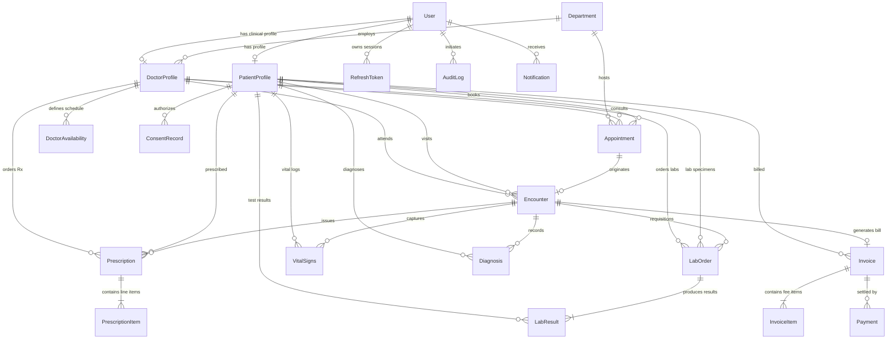

# MediCore - Clinical Relational Database Entity-Relationship (ER) Architecture
**Assessment 03: Clinical Relational Database**

The MediCore PostgreSQL database enforces 3NF relational normalization, foreign key constraints, cascade triggers, optimistic locking, and compound unique indexes to guarantee clinical data integrity and prevent race conditions.

## Concurrency and Integrity Safeguards
1. **Double-Booking Prevention**: Database-level compound index on `(doctorId, scheduledStartTime)` paired with serializable transaction locks during slot allocation.
2. **Medical Record Number (MRN)**: System-generated unique identifier format `MRN-YYYY-XXXX` indexed for fast clinical lookups.
3. **Session Revocation**: Stored refresh token hashes with `revoked` and `revokedAt` timestamps enabling immediate global revocation upon logout or credential reset.
4. **Consent-Aware Enforcing**: Every sensitive patient retrieval checks against `ConsentRecord` table for matching patient authorization.
5. **Immutable Audit Trail**: Append-only `AuditLog` table capturing action type, user ID, role, resource entity, request correlation ID, and IP address.
